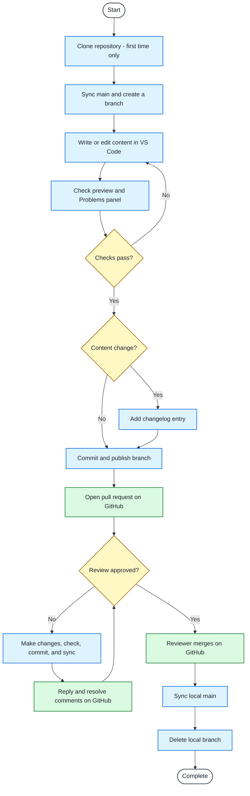

# Contributing Documentation Changes Through a GitHub Pull-Request Workflow

> **Portfolio sample.** The documentation team, its rules, and its style guide are fictional. The procedure was tested in VS Code and GitHub in October 2026, with one person acting as both author and reviewer. Because GitHub doesn't let authors review or approve their own pull requests, the steps for requesting a review (B8 step 8) and the reviewer's approval (C3) were written from GitHub's documentation, not tested.

| Field | Value |
| --- | --- |
| Document ID | DOC-SOP-001 |
| Version | 1.2 |
| Owner | Maintainer |
| Effective date | 2026-10-30 |
| Next review date | 2027-04-30 |

## 1. Purpose

This procedure describes how contributors propose changes to the documentation team's content, and how those changes are reviewed and merged. Every change goes through a pull request: a reviewer from the documentation team checks and approves it before it's merged, and GitHub keeps a record of what changed, when, and why.

## 2. Audience

This procedure is for writers, subject-matter experts, and new team members who contribute to the documentation team's content. It assumes you can write and edit documentation and know basic Markdown, but haven't used Git, GitHub, or VS Code to make documentation changes. Terms such as branch and maintainer are explained in [Key terms](#5-key-terms). You don't need to type Git commands: VS Code runs Git for you through its buttons, apart from two setup commands in [Prerequisites](#4-prerequisites).

## 3. Scope

### When to use this procedure

Use this procedure whenever you want to add, change, or remove content in the documentation repository.

### What this procedure covers

- Cloning the documentation repository to your computer (first time only).
- The cycle for each change: creating a branch, writing or editing content in VS Code, checking your work, adding a changelog entry for content changes, committing, publishing the branch, opening a pull request, and responding to review comments.
- After a reviewer merges your pull request: updating your local main branch and deleting your local branch.
- The team's rules for branches, commit messages, pull requests, the changelog, and review.
- Steps for the author only. What reviewers and the maintainer do is listed in [Roles and responsibilities](#6-roles-and-responsibilities).

### What it doesn't cover

- Installing tools (see [Prerequisites](#4-prerequisites)).
- Using Git from the command line (typing Git commands instead of using VS Code's buttons).
- Editing files in GitHub's browser editor. The team allows it only for typo fixes, which still need a pull request.
- Contributing from a fork (used by contributors without access to the repository).
- Resolving merge conflicts. If GitHub reports a conflict, stop and contact the maintainer.
- Signing commits. If your team requires signed commits, follow your onboarding instructions.
- macOS. The steps were tested on Windows.
- Writing style and content standards. Follow the team style guide.
- Publishing or building the documentation site.

## 4. Prerequisites

Before you start, make sure you have:

- A GitHub account, added to the documentation repository by the maintainer.
- The repository address, from the maintainer.
- VS Code installed ([code.visualstudio.com](https://code.visualstudio.com)).
- Git installed ([git-scm.com](https://git-scm.com)).
- Git configured with your name and your GitHub no-reply email address (see the note below).
- These VS Code extensions: markdownlint (David Anson) and Code Spell Checker (Street Side Software). The repository offers to install them when you open it. Check for the blue verified tick next to the publisher's name, so you install the real extension and not a fake one with a similar name (often called a copycat).
- Basic Markdown knowledge (see [Basic writing and formatting syntax](https://docs.github.com/en/get-started/writing-on-github/getting-started-with-writing-and-formatting-on-github/basic-writing-and-formatting-syntax) in GitHub's documentation).

> **Note: configure Git before your first commit.** Every commit records a name and an email address, and anyone who can see the repository can see them. To keep your personal email private, use the no-reply address shown in GitHub under **Settings > Emails**, with **Keep my email addresses private** turned on. In VS Code, open **Terminal > New Terminal** and run these two commands, with your own name and address:
>
> ```text
> git config --global user.name "Your Name"
> git config --global user.email "your-no-reply-address"
> ```

## 5. Key terms

| Term | Meaning |
| --- | --- |
| Branch | A separate line of work in the repository. You make each change on your own branch, so main isn't affected until your pull request is merged. |
| Clone | Copy a repository, with its full history, from GitHub to your computer. Your copy stays linked to GitHub, so you can sync changes, but it doesn't update by itself. |
| Commit | Save a set of staged changes to the history, with a message describing them. |
| Diff | A view of what changed in a file: removed lines in red, added lines in green. You see diffs in VS Code when you click a file in Source Control, and on GitHub on a pull request's **Files changed** tab. |
| Graph | The list at the bottom of the Source Control panel that shows the repository's commits, newest at the top. Labels mark where each branch is: a label with a circle icon is a branch on your computer, and a label with a cloud icon is a branch as it is on GitHub, for example `origin/main`. |
| main | The repository's default branch, which holds the official version of the documentation. Nobody edits main directly: every change comes from another branch, through a pull request. |
| Maintainer | The member of the documentation team who manages the repository: gives contributors access, resolves problems such as merge conflicts, and owns this procedure. |
| Merge | Add the changes from one branch into another. In this procedure, the reviewer merges your branch into main on GitHub. |
| origin | Git's name for the copy of the repository on GitHub. In VS Code's branch list, `origin/main` is main as it was on GitHub the last time VS Code checked, and plain `main` is your copy on your computer. |
| Publish | Push a new branch to GitHub for the first time. In VS Code, this is the **Publish Branch** button. |
| Pull request | A request, made on GitHub, to merge your branch into main. Reviewers read and comment on the changes there. |
| Push | Send your commits from your computer to GitHub. |
| Repository (repo) | The folder of documentation files, together with the full history of every change. |
| Stage | Mark changes for the next commit. Staged files wait under **Staged Changes** in Source Control until you commit them. Changes you don't stage stay out of that commit. |
| Sync | Download any new changes from GitHub to your computer, then send your commits to GitHub. In VS Code, this is the **Sync Changes** button, or the sync icon next to the branch name in the bottom-left corner of the VS Code window. |

## 6. Roles and responsibilities

| Role | Responsibilities |
| --- | --- |
| Author | Follows this procedure: makes the change on a branch, checks it, opens a pull request and requests a review, and responds to review comments. After the merge, updates main on their computer and deletes the local branch (D1, D2). |
| Reviewer | A member of the documentation team. Reviews the pull request within two working days, comments, approves, and merges. Asks for a subject-matter expert (SME) review when a change affects technical accuracy. Deletes the branch on GitHub after merging. |
| Maintainer | Owns the repository. Gives contributors access, resolves merge conflicts, and handles escalations. Owns this procedure and checks that it's still accurate by the next review date. |
| SME reviewer | When the reviewer asks, checks a change for technical accuracy and comments on the pull request. |

## 7. Team rules

| Rule | What the team does |
| --- | --- |
| Approval | One approval, from a reviewer on the documentation team, before merging. The reviewer can ask for an SME review. |
| Merging | The reviewer merges, after approving, using **Create a merge commit**. Authors don't merge their own pull requests. |
| Branch names | Lowercase with hyphens, describing the change, for example `update-login-steps` or `add-reset-password-page`. Add a ticket number if the change has one, for example `docs-142-update-login-steps`. |
| Commit messages | Follow the [commit message rules](#commit-message-rules) below this table. |
| Pull request description | Complete every section of the [pull request template](.github/pull_request_template.md): What changed, Why, Notes for the reviewer, and Checks (tick boxes for the checks in B4 and the changelog entry in B5). |
| Changelog | Add an entry to `CHANGELOG.md` for every content change (B5). Typo fixes and housekeeping changes don't need one. |
| Review time | The reviewer responds within two working days. |
| Stalled review | If there's no response within two working days, follow C4: mention the reviewer on the pull request, then ask in the team channel, then contact the maintainer. |
| Unresolved comments | The reviewer doesn't merge while any line comment is unresolved or any comment has no reply. The author replies to every comment and resolves each line comment once it's addressed. |
| Skipping review | Never. Every change goes through a pull request and review, even a typo fix made in GitHub's browser editor. |

### Commit message rules

1. Start with a verb in command form, such as Add, Fix, Update, Remove, Rename, or Revert.
2. Name the page or file, so the change can be found in the history later.
3. Say what changed, not just that something was fixed. Use Fix for errors such as typos and broken links.
4. Keep it to about 50 characters, with no full stop at the end.
5. Capitalize only the first word and proper names. Put extra detail in the pull request description.

These examples show the rules in practice. The page names are illustrations, not pages in this repository.

| Too vague or too long | Better |
| --- | --- |
| Add page about resetting passwords | `Add Reset Your Password page` |
| Update steps because the login screen changed | `Update login steps in Getting Started` |
| Fix headers on all pages | `Use sentence case for headings on all pages` |
| Revert commit that deleted the Getting Started introduction | `Revert removal of Getting Started introduction` |

Write your own commit messages. Don't use the AI suggestion (the sparkle icon) in the commit message box.

## 8. Environment and tools used

The steps were tested with these tools and versions. Menus and labels can change in later versions.

| Tool | Tested with |
| --- | --- |
| Windows | Windows 11, version 25H2 |
| VS Code | 1.142.0 to 1.143.1 |
| Git | 2.56.0.windows.2 |
| markdownlint extension | 0.62.1 |
| Code Spell Checker extension | 4.10.0 |
| GitHub | Web interface, October 2026 |
| Mermaid | Built into GitHub and VS Code's Markdown preview |

## 9. Workflow overview

In the diagram, blue boxes are steps in VS Code on your computer, green boxes are steps on GitHub, yellow diamonds are decisions, and white ovals mark the start and the end.



Two steps can repeat. If the checks fail, go back and fix your content before you commit. If the review isn't approved, make the requested changes and reply to the comments, until the reviewer approves.

## 10. Procedure

### A. One-time setup: clone the repository

Do this once, before your first change. If you later work on another computer, do it there too.

> **Warning:** clone into a folder that's only on your computer, such as `C:\Users\<your-name>\GitHub`. Don't clone into a folder that a cloud storage service such as OneDrive, Dropbox, or Google Drive copies automatically. These services can lock or change Git's hidden files while Git is using them, which can damage your copy of the repository.

1. On GitHub, open the repository, click the green **Code** button, make sure **HTTPS** is selected, and click the copy icon next to the address. Copy it now, before you open the clone box in VS Code: that box closes if you click away from it.
2. In VS Code, if a folder is already open, click **File > Close Folder**. The Welcome page appears. If it doesn't, click **Help > Welcome**.
3. On the Welcome page, under **Start**, click **Clone Git Repository…**, paste the address you copied from GitHub in step 1 into the box at the top, and press **Enter**.
4. A window opens, titled **Choose a folder to clone … into**. Go to your local folder (for example `GitHub`), and click **Select as Repository Destination**. If you don't have one yet, click **New folder** at the top of the window, type `GitHub`, press **Enter**, then click **Select as Repository Destination**. Don't select a folder inside it: VS Code creates the repository's folder for you. If a window asks you to sign in to GitHub, follow its steps. If it opens your browser, check that the address bar says **github.com**, then approve it.
5. When VS Code asks whether to open the cloned repository, click **Open**.
6. If VS Code asks whether you trust the authors of the files, click **Yes, I trust the authors**. If a blue **Restricted Mode** label appears in the bottom-left corner instead, click it. On the **Workspace Trust** page that opens, click **Trust**. Don't click **Add Folder** at the bottom of the page. It's for adding more folders to your trusted list.

**Result:** the Explorer (the file list on the left of the window) shows the repository's name and files, and the bottom-left corner of VS Code shows **main**. Your repository's name and files will be different from the example below.


### B. Make a change

#### B1. Start from an up-to-date main

Do this before every change. If you've just cloned the repository (part A), main is already up to date, so you can go straight to B2.

1. Check that the bottom-left corner shows **main**, with no asterisk. If it shows another branch, click it and choose **main** from the list (plain `main`, not `origin/main`).
2. Click the **Source Control** icon, the third icon in the bar on the far left of the window (branching lines). Check that no files are listed under the **Changes** heading. If the corner shows **main\*** or files are listed, see [Troubleshooting](#11-troubleshooting).
3. Click the sync icon (two circular arrows) next to **main** in the bottom-left corner, to download the latest changes from GitHub. If VS Code asks you to confirm, click **OK**.

**Result:** main on your computer matches main on GitHub, and Source Control shows no changes.

#### B2. Create a branch

1. Click **main** in the bottom-left corner. A box opens at the top of the window.
2. Click **Create new branch**.
3. Type a branch name that follows the team rules, for example `update-login-steps`, and press **Enter**.

**Result:** the bottom-left corner shows your branch name, with a cloud icon with an up arrow beside it. That's the **Publish Branch** icon: the branch isn't on GitHub yet. You publish it in B7.

#### B3. Edit and save

> **Warning:** never add confidential information to the repository. Anyone with access can see every file and every commit. Git keeps every earlier version, so deleting the information later doesn't remove it from the history. If you've added some by mistake and haven't committed yet, delete it and save. If you've already committed it, see [Escalation](#12-escalation).

1. In the Explorer, click the file you want to change. It opens in the editor.
   - To create a new file: right-click the folder it belongs in and choose **New File**. For a file at the top level (not inside any folder), click a top-level file such as `README.md`, then point at the repository name at the top of the Explorer and click the **New File** icon (a page with **+**). Type the name, ending in `.md`, in the box that appears, and press **Enter**. `.md` marks the file as Markdown, so VS Code can preview and check it.
   - To delete a file: right-click it, choose **Delete**, then **Move to Recycle Bin**. Leave **Do not ask me again** unticked, so VS Code keeps asking before it deletes a file.
2. Make your change, then press **Ctrl + S** to save. A white dot on the file's tab means the file has changes you haven't saved yet. It disappears when you save.

> **Tip:** to start a new line after a long line (one that wraps onto several lines on screen), click anywhere in it, then press **End** twice. The first press only goes to the end of the line on screen. The second goes to the real end of the line. Then press **Enter**. If you press **Enter** in the middle of a line, it splits in two, and in a table that breaks the row.

**Result:** the tab shows no white dot, and the file shows **M** (modified) or **U** (new) in the Explorer. A deleted file disappears from the Explorer and shows **D** in Source Control.

#### B4. Check your work

1. Open the preview. It shows the file as readers will see it, formatted and without the Markdown symbols. Click **Open Preview to the Side**, the icon with a magnifying glass at the top right of the editor, or press **Ctrl + K**, then **V**. The preview opens beside the file. To see only the preview instead, click **Open as Preview**, the icon next to it. Check that headings, lists, tables, links, and diagrams display as intended.
2. Press **Ctrl + Shift + M** to open the **Problems** panel. It opens at the bottom of the window, under the file, and lists every warning in the files you have open. In the file, each warning is marked with a wavy line.
   - markdownlint warnings point out Markdown formatting mistakes, such as too many blank lines. Each one names a rule, such as MD012: click the rule code to open its documentation, with examples.
   - To fix a markdownlint warning, point at the wavy line and click **Quick Fix…** in the box that appears, or press **Ctrl + .** (Ctrl and the full stop key). Choose an option with a yellow light bulb, such as **Fix this violation of …**. Don't choose an option with a sparkle icon, such as **Fix** or **Explain**: these are AI suggestions. Then check the preview to make sure the text still reads correctly.
   - Fix every spelling notice that's a real typo. The spell checker doesn't catch every mistake: see the Note below.
3. For a correct word the spell checker doesn't know, such as a product name, click the underlined word, then the yellow light bulb that appears at the start of its line, and choose the option that adds the word to **User Settings**. VS Code then accepts that word in every repository on your computer. Don't choose Workspace Settings: that creates a settings file in the repository.

> **Note:** markdownlint and the spell checker don't check everything. A table whose separator row has the wrong number of columns displays as plain text, and markdownlint doesn't flag it. JSON inside a code block isn't checked either. The spell checker skips words shorter than four letters, such as "teh", and doesn't flag real words used in the wrong place, such as "type" for "typo". Read your change in the preview before you commit.

**Result:** the preview looks right, and the Problems panel shows no problems.

#### B5. Add a changelog entry (content changes only)

If your change affects the content, accuracy, or structure of the documentation (a new or removed page, updated wording, a corrected example or code sample, or a changed diagram), add an entry to `CHANGELOG.md`. Skip this step for typo fixes and housekeeping: changes readers don't notice, such as formatting fixes or changes to settings files.

1. Open `CHANGELOG.md`.
2. Below the introduction, add a heading with today's date, followed by one bullet per change. Newest entries go at the top:

   ```markdown
   ## 2026-10-19

   - Updated the login steps on the Getting Started page
   ```

3. Press **Ctrl + S** to save the file, check that the tab has no white dot, and check the Problems panel (B4 step 2).

**Result:** the new entry is the first entry in the changelog.

#### B6. Stage and commit

1. Click the **Source Control** icon (the third icon in the bar on the far left). The panel shows the **Changes** section at the top and the **Graph** below it. If the Changes section is closed, click the **Changes** heading at the top of the panel to open it.
2. Check that the bottom-left corner shows your branch (not main), that VS Code's title bar shows the documentation repository, that no tab shows a white dot, and that the Changes list holds only the files for this change. Changes you haven't saved aren't included in the commit.
3. Click each file in the Changes list to see exactly what you changed. Check that every change is one you meant to make.
4. Stage the files for this commit. To stage one file, point at it and click its **+** (**Stage Changes**). To stage every file in the list, point at the **Changes** line above the files and click its **+** (**Stage All Changes**). Don't click the curved arrow (**Discard Changes**) beside the **+**: it discards your changes. Staged files move into a new list, **Staged Changes**, just above **Changes**.
5. In the message box at the top of the panel, above **Commit**, write a commit message. Check that it follows the [commit message rules](#commit-message-rules), has no typos, and describes this change: once it's pushed, it can't be changed.
6. Click **Commit**.

> **Note:** if you click **Commit** before staging, VS Code says "There are no staged changes to commit" and offers to stage all your changes and commit them. Click **Cancel**, stage the files you want (step 4), and commit again. Staging everything can include changes you didn't mean to commit. Don't click **Always**: VS Code would then stop asking, and stage and commit all your changes whenever you click **Commit** with nothing staged.

Before you click **Commit**, Source Control looks like this. In the Graph, the cloud icon marks main as it is on GitHub. Your branch has no cloud yet, because it isn't on GitHub:


**Result:** the Changes list is empty, and your commit appears at the top of the Graph, with your branch's label beside it.

#### B7. Publish the branch

1. In Source Control, click **Publish Branch**. You only do this once for each branch: after that, the same button shows **Sync Changes**, which you click for later commits on the same branch.
2. If this is your first push and a window asks you to sign in to GitHub, follow its steps. If it opens your browser, check that the address bar says **github.com**, then approve it. GitHub may ask for your password again; that's expected. The page then goes blank; close it.

**Result:** the bottom-left corner shows your branch name with a sync icon instead of the cloud icon with an up arrow, and in the Graph, your branch label has a cloud icon beside it, meaning it's also on GitHub.

> **Tip:** in the Graph, a label with a cloud icon shows where the branch is on GitHub. When it's on the same commit as your branch, GitHub has all your commits.

#### B8. Open a pull request and request a review

1. On GitHub, open the repository and refresh the page. A banner says your branch had recent pushes. Click **Compare & pull request**. If there's no banner, see [Troubleshooting](#11-troubleshooting).
2. Check that the bar near the top of the page shows **base: main**, an arrow (←), and **compare:** with your branch name.
3. Keep or edit the title. If your branch has one commit, the title is its commit message. If it has more, GitHub uses the branch name instead: edit it to follow the commit message rules.
4. Fill in the description. GitHub fills the box automatically with this repository's [pull request template](.github/pull_request_template.md). It has four headings: **What changed**, **Why**, **Notes for the reviewer**, and **Checks**. Under each of the first three is a hint between `<!--` and `-->` that says what to write there. The hints don't appear in the finished pull request. Write your answer below each hint. The line at the very top, `<!-- markdownlint-disable-file MD041 -->`, is a setting for markdownlint: leave it as it is.
5. Under **Checks**, there's a list of the checks from B4 and B5, each starting with `- [ ]`. Each tick tells the reviewer you did that check. For each check you completed, type an `x` between the brackets, with no spaces: `- [x]`. Leave a check unticked only if it doesn't apply to your change, for example the changelog check for a typo fix.
6. Click the **Preview** tab above the box. Check that the description reads correctly and that each ticked check shows as a ticked box. If anything is wrong, click **Write** to go back and fix it.
7. When everything is correct, click **Create pull request**.
8. On the right of the pull request, click **Reviewers** and choose a reviewer from the documentation team.

The banner in step 1 looks like this. Your repository's files and branch name will be different:


**Result:** the pull request shows a green **Open** label and the reviewer's name under **Reviewers**.

### C. Respond to review

#### C1. Read the review comments

GitHub notifies you when the reviewer comments. Open the pull request on GitHub to read and answer the comments. There are two kinds:

- **Line comments** are attached to a specific line of your change. They appear on the **Files changed** tab, next to the line.
- **General comments** are about the pull request as a whole. They appear on the **Conversation** tab.

Read every comment of both kinds.

#### C2. Make the requested changes

1. In VS Code, check that the bottom-left corner shows your branch, not main. If it shows main, click it and choose your branch from the list.
2. Make the changes, then check your work (B4), stage and commit (B6), and click **Sync Changes**.

Your new commits are added to the same pull request automatically. Don't open a new one. If you don't agree with a requested change, don't make it: explain why in your reply (C3). If you and the reviewer still can't agree, see [Escalation](#12-escalation).

#### C3. Reply and resolve

1. On GitHub, reply to every comment, saying what you changed, or why you didn't.
2. For each line comment you've addressed, click **Resolve conversation** under it on the **Files changed** tab. General comments don't have this button: your reply is enough.

The reviewer then either approves your pull request and merges it into main (part D), or adds more comments. If they add more comments, repeat C1 to C3.

#### C4. If the review stalls

If the reviewer hasn't responded within two working days:

1. Add a comment on the pull request that mentions the reviewer, asking them to review it. To mention someone, type `@` followed by their GitHub username, for example `@reviewer-name`. GitHub notifies them.
2. If there's still no response after another working day, post in the team channel, with the pull request link, asking for a review.
3. If there's still no review after that, contact the maintainer. See [Escalation](#12-escalation).

### D. After the merge on GitHub

#### D1. Update your local main

The reviewer has merged your change into main on GitHub, but main on your computer doesn't have it yet. This step downloads it, so your copy matches GitHub before your next change.

1. In VS Code, click your branch name in the bottom-left corner and choose **main** from the list (plain `main`, not `origin/main`). Your change is now part of main, so main is the branch to update. The files still show the old version until you sync in step 2. That's expected.
2. Click the sync icon (two circular arrows) next to **main** in the bottom-left corner. If VS Code asks you to confirm, click **OK**.

**Result:** in the Graph, the **main** label sits on the top line, next to the merge commit, with a cloud icon beside it. The files show the merged version.

#### D2. Delete your local branch

Your change is now in main, so you don't need your branch any more. Deleting it keeps your branch list short, so you don't make your next change on an old branch by mistake.

1. Press **Ctrl + Shift + P**. The Command Palette opens: a box at the top of the window where you run VS Code commands. It starts with `>`. Keep it: without it, the box searches file names instead of commands.
2. Type `Git: Delete Branch` and choose it.
3. Choose the branch you've just merged, the one named in your pull request. Check the name before you choose it.

If VS Code warns that the branch isn't fully merged, the branch has commits that aren't on GitHub. Stop and contact the maintainer. Don't force the deletion.

**Result:** your branch no longer appears under **branches** in the branch list (click the branch name in the bottom-left corner to open it). A copy named `origin/` followed by your branch name, for example `origin/update-login-steps`, may still appear under **remote branches**: it's VS Code's record of the branch as it was on GitHub before it was deleted there. Don't choose it, because choosing it creates a new local copy of the branch. To clear it from the list, press **Ctrl + Shift + P**, type `Git: Fetch (Prune)`, and choose it.

## 11. Troubleshooting

### In VS Code

| Problem | Cause | Fix |
| --- | --- | --- |
| Source Control shows **Initialize Repository** and **Publish to GitHub** | The open folder doesn't have a Git repository | Don't click either. If you've already cloned the repository, open its folder with **File > Open Recent**. If not, click **File > Close Folder**, then clone it: see [part A](#a-one-time-setup-clone-the-repository). |
| The clone box closed before you pasted the address | You clicked away from the box | Copy the address on GitHub first. Then click **Clone Git Repository…** again, and paste the address into the box (part A step 3). |
| VS Code asks **Would you like to open the repository?** without showing a folder window | You already have a copy of the repository on your computer | Click **Open**. VS Code opens your existing copy; nothing new is downloaded. |
| A blue **Restricted Mode** label appears in the bottom-left corner | VS Code doesn't trust the folder yet | Click the label. On the **Workspace Trust** page that opens, click **Trust**. Don't click **Add Folder** at the bottom of the page. Trust only your team's repositories. |
| The bottom-left corner shows **main\*** (with an asterisk) | You changed files on main before creating a branch | Click **main\***, then **Create new branch**. Your changes come with you to the new branch. |
| A file's tab shows a white dot, but you don't remember changing that file | The file has changes you haven't saved, for example from typing in it by accident | Click the tab and look at the file. If the changes are ones you want, press **Ctrl + S** to save them. If not, close the tab and click **Don't Save**. If you've already saved unwanted changes, open the file in Source Control to see them, then choose **Discard Changes** (the curved arrow beside the file) to put back the last committed version. This removes all your uncommitted changes in that file. |
| You deleted a file by mistake | The file was deleted in the Explorer | In Source Control, point at the file (marked **D**), click **Discard Changes** (the curved arrow beside the file), then **Restore File**. |
| A table displays as plain text | The separator row doesn't have the same number of columns as the header | Give the separator row one `---` cell per column, so it matches the header. Then check the preview: the table should display as a table. |
| A table row is split across two lines | **Enter** was pressed in the middle of a wrapped line | Click anywhere in the first part of the row, press **End** twice to go to its true end, then press **Delete** (**Del**) once to join the next line back on. Check the preview. To avoid splitting a row next time, see the Tip in B3. |
| Text displays as raw code | A code block is missing its closing fence | Add three backticks on their own line where the code block should end. |
| Part of a page is missing from the preview | An HTML comment (`<!--`) was never closed | Find the `<!--` above the missing part and add `-->` where the comment should end. |
| Headings or paragraphs display as code or don't format after pasting | Pasted text brought hidden spaces at the start of lines | Select the lines and press **Shift + Tab** until they start at the left edge. If a line doesn't move, click just before its first word and press **Backspace** until it does. |
| A correct word is underlined as a spelling mistake | The word isn't in the spell checker's dictionary | It's also listed in the **Problems** panel. Click the underlined word, then the yellow light bulb that appears at the start of its line, and choose the option that adds the word to **User Settings**. Don't choose Workspace Settings: that creates a settings file in the repository. |
| "There are no staged changes to commit" | The staging step was skipped | Click **Cancel**, stage the files (B6 step 4), then commit. Don't click **Always**: VS Code would then stop asking, and stage and commit all your changes whenever you click **Commit** with nothing staged. |
| The Command Palette shows file names or **No matching results** instead of commands | The `>` at the start of the box is missing | Click in the box, type `>` before anything else, then type the command again. Or press **Esc**, then **Ctrl + Shift + P** to open the box again. |

### On GitHub

| Problem | Cause | Fix |
| --- | --- | --- |
| The **Compare & pull request** banner doesn't appear | The banner only appears for a short time after a push, and not if a pull request is already open for the branch | If a pull request is already open for your branch, you don't need a new one: your commits are added to it (C2). Otherwise, on GitHub, open the repository and click **Pull requests**, then **New pull request**. Set **base** to **main** and **compare** to your branch. Click **Create pull request** to open the form, then continue from B8 step 3. |
| GitHub says **There isn't anything to compare** | The branch in **compare** has no changes that aren't already on main: it's the wrong branch, your commits haven't reached GitHub, or it's already merged | Click the **compare** button and choose your branch. If your branch isn't in the list, it isn't on GitHub yet: publish it (B7). If it was already your branch, look at the bottom-left corner in VS Code: a number with an up arrow beside the sync icon, for example **1↑**, means your commits are still only on your computer. Click **Sync Changes**, then refresh the page on GitHub. If your branch has already been merged, there's nothing to do: your change is already in main. |
| You clicked **Create pull request** before filling in the description | The form was submitted before the description was complete | On the **Conversation** tab, your description is the first box, at the top. Click **…** (three dots) at its top right, then **Edit**. Complete every section of the template (B8 steps 4 and 5), then click **Update comment**. GitHub treats the description as the pull request's first comment, which is why the button says **Update comment**. |
| The pull request banner appears on the wrong repository | The commit was made in another repository's folder | Don't open the pull request. Contact the maintainer. Next time, check VS Code's title bar before committing (B6 step 2). |
| Some commits on GitHub show a **Verified** label, and yours don't | Commits made on your computer aren't signed | Nothing is wrong. **Verified** means a commit was signed, which proves who made it. Merges done on GitHub are signed by GitHub, so they show it. Signing commits isn't covered by this procedure; follow your onboarding instructions if your team requires it. |

## 12. Escalation

| Situation | Contact | Include |
| --- | --- | --- |
| **On GitHub:** the pull request reports a merge conflict | Maintainer | The pull request link and the files named in the conflict |
| **On GitHub:** no review after two working days | Reviewer, then the team channel, then the maintainer (see C4) | The pull request link |
| **On GitHub:** you and the reviewer can't agree on a requested change | Maintainer, after you've replied to the comment with your reasons (C3) | The pull request link and the comment you disagree about |
| **In VS Code or on GitHub:** you can't clone, push, or see the repository | Maintainer | Your GitHub username and the repository name |
| **In VS Code:** an error message appears when you publish or sync | Maintainer | A screenshot of the message (press **Windows + PrtScn** before you click anything), and your branch name |
| **In VS Code or on GitHub:** you committed on main, or published to the wrong repository | Maintainer | The repository name, the branch name, and what you committed |
| **In VS Code:** a warning says a branch isn't fully merged | Maintainer | The branch name and the warning text |
| **Any time:** a step in this procedure doesn't match what you see, or seems wrong | Maintainer | The step number (for example B6 step 3), what you expected, what you saw, and a screenshot |
| **Any time:** you added confidential information (such as a password, a key, or personal data) to a commit | Maintainer, straight away (don't publish or sync until they reply) | The repository name, the branch name, and the file name, but not the confidential information itself |
| **Any time:** a question this procedure doesn't answer | Reviewer or maintainer | What you were doing and what you saw |

## 13. Completion criteria

The procedure is complete when:

- The pull request description has every section of the template completed, with every check that applies ticked.
- The pull request is approved and merged, with every comment answered and every line comment resolved.
- For a content change, the merged pull request includes a `CHANGELOG.md` entry.
- Your local main is up to date with GitHub ([D1](#d1-update-your-local-main)): the bottom-left corner shows **main** with no asterisk, and Source Control shows no changes.
- Your branch is deleted on GitHub, and you've deleted your local branch ([D2](#d2-delete-your-local-branch)).

## 14. Records

| Record | Where it's kept |
| --- | --- |
| The change, its description, the review, and the approval | The pull request on GitHub |
| Every commit, with author, date, and exact changes | The repository's commit history, on GitHub and in every clone. On GitHub, click **Commits** above the file list on the repository's main page. On a file's page, **Blame** shows which commit last changed each line. In VS Code, see the Graph. |
| Content changes, newest first | [CHANGELOG.md](CHANGELOG.md) |
| Versions of this procedure | [Revision history](#16-revision-history), at the end of this document |

GitHub keeps pull requests and commit history automatically, for as long as the repository exists. Apart from the changelog entry ([B5](#b5-add-a-changelog-entry-content-changes-only)), you don't need to keep any other record of your change.

## 15. Related documents

- Documentation team style guide (internal)
- [Pull request template](.github/pull_request_template.md), in this repository
- [CHANGELOG.md](CHANGELOG.md), in this repository
- [About pull requests](https://docs.github.com/en/pull-requests/get-started/about-pull-requests), GitHub documentation
- [Creating a pull request](https://docs.github.com/en/pull-requests/how-tos/create-pull-requests/creating-a-pull-request), GitHub documentation
- [Setting your commit email address](https://docs.github.com/en/account-and-profile/how-tos/email-preferences/setting-your-commit-email-address), GitHub documentation
- [Basic writing and formatting syntax](https://docs.github.com/en/get-started/writing-on-github/getting-started-with-writing-and-formatting-on-github/basic-writing-and-formatting-syntax), GitHub documentation
- [Source control in VS Code](https://code.visualstudio.com/docs/sourcecontrol/overview), VS Code documentation
- [Working with repositories and remotes](https://code.visualstudio.com/docs/sourcecontrol/repos-remotes), VS Code documentation
- [Workspace Trust](https://code.visualstudio.com/docs/editing/workspaces/workspace-trust), VS Code documentation
- [markdownlint rules](https://github.com/DavidAnson/markdownlint/blob/main/doc/Rules.md), markdownlint documentation

## 16. Revision history

| Version | Date | Author | Changes |
| --- | --- | --- | --- |
| 1.0 | 2026-10-26 | Georgia Lainiotis | First version. Drafted and tested in October 2026, and revised after a full review before merging. |
| 1.1 | 2026-10-26 | Georgia Lainiotis | Updated the D2 result to explain the `origin/` copy of a deleted branch and how to clear it. |
| 1.2 | 2026-10-30 | Georgia Lainiotis | Revised after a full read-through: clearer steps and results throughout, a Graph key term, a revised diagram, new and corrected Troubleshooting rows, and links between sections. Each change was tested in VS Code and on GitHub where possible. |

© 2026 Georgia Lainiotis. All rights reserved.
