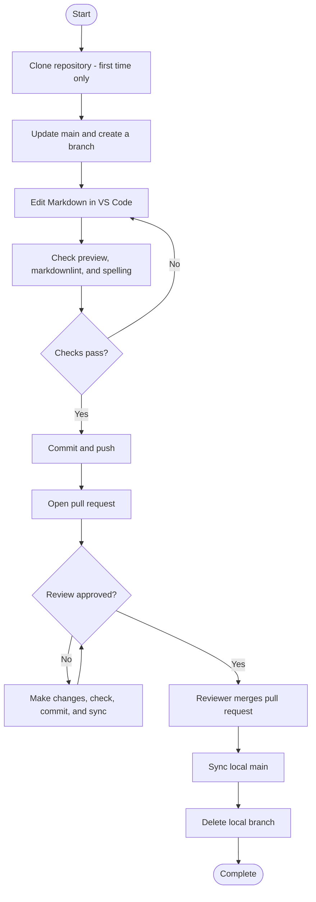

# Contributing Documentation Changes Through a GitHub Pull-Request Workflow

> **Portfolio sample.** The documentation team, its rules, and its style guide are fictional. The procedure was tested in VS Code and GitHub in October 2026, with one person acting as both author and reviewer.

| Field | Value |
| --- | --- |
| Document ID | DOC-SOP-001 |
| Version | 1.0 |
| Owner | Maintainer |
| Effective date | YYYY-MM-DD |
| Next review date | YYYY-MM-DD |

## 1. Purpose

This procedure describes how contributors propose changes to the documentation team's content, and how those changes are reviewed and published. Every change goes through a pull request: a reviewer from the documentation team checks and approves it before readers see it, and GitHub keeps a record of what changed, when, and why.

## 2. Audience

This procedure is for writers, subject-matter experts, and new team members who contribute to the documentation team's content. It assumes you can write and edit documentation and know basic Markdown, but have not used Git, GitHub, or VS Code to make documentation changes. Terms such as branch and maintainer are explained in [Key terms](#6-key-terms) and briefly where they first appear. You don't need to type Git commands: VS Code runs Git for you through its buttons, apart from two setup commands.

## 3. Scope

### When to use this procedure

Use this procedure whenever you want to add, change, or remove content in the documentation repository.

### What this procedure covers

- Cloning the documentation repository to your computer (first time only).
- The cycle for each change: creating a branch, editing Markdown in VS Code, checking your work, adding a changelog entry for content changes, committing, publishing the branch, opening a pull request, and responding to review comments.
- After a reviewer merges your pull request: updating your local main branch and deleting your branch.
- The team's rules for branches, commit messages, pull requests, the changelog, and review.
- The author's steps. Reviewer and maintainer responsibilities are described in [Roles and responsibilities](#4-roles-and-responsibilities), not as steps.

### What it doesn't cover

- Installing tools (see [Prerequisites](#7-prerequisites)).
- Using Git from the command line.
- Editing files in GitHub's browser editor. The team allows it only for typo fixes, which still need a pull request.
- Contributing from a fork (used by contributors without access to the repository).
- Resolving merge conflicts. If GitHub reports a conflict, stop and contact the maintainer.
- Signing commits. If your team requires signed commits, follow your onboarding instructions.
- macOS. The steps were tested on Windows.
- Writing style and content standards. Follow the team style guide.
- Publishing or building the documentation site.

## 4. Roles and responsibilities

| Role | Responsibilities |
| --- | --- |
| Author | Follows this procedure: makes the change on a branch, checks it, opens a pull request, and responds to review comments. |
| Reviewer | A member of the documentation team. Reviews the pull request within two working days, comments, approves, and merges. Asks for a subject-matter expert (SME) review when a change affects technical accuracy. Deletes the branch on GitHub after merging. |
| Maintainer | Owns the repository. Gives contributors access, resolves merge conflicts, and handles escalations. Owns this SOP and reviews it by the next review date. |
| SME reviewer | When asked, checks a change for technical accuracy and comments on the pull request. |

## 5. Team rules

| Rule | What the team does |
| --- | --- |
| Approval | One approval from the documentation team before merging. The reviewer can ask for an SME review. |
| Merging | The reviewer merges, after approving. Authors don't merge their own pull requests. |
| Branch names | Lowercase with hyphens, describing the change, for example `update-login-steps`. Add a ticket number if the change has one, for example `docs-142-update-login-steps`. |
| Commit messages | Follow the commit message rules below. |
| Pull request description | Complete every section of the pull request template: What changed, Why, Notes for the reviewer, and Checks. |
| Changelog | Content changes get an entry in `CHANGELOG.md`. Typo fixes and housekeeping changes don't. |
| Review time | The reviewer responds within two working days. |
| Stalled review | Mention the reviewer on the pull request, then ask in the team channel, then contact the maintainer. |
| Unresolved comments | The reviewer doesn't merge while any review comment is unresolved. The author resolves each comment once it's addressed. |
| Skipping review | Never. Typo fixes made in GitHub's browser editor still go through a pull request. |

### Commit message rules

1. Start with a verb in command form: Add, Fix, Update, Remove, Rename, Revert.
2. Name the page or file, so the change can be found in the history later.
3. Say what changed, not just that something was fixed. Use Fix for errors such as typos and broken links.
4. Keep it to about 50 characters, with no full stop at the end.
5. Capitalize only the first word and proper names. Put extra detail in the pull request description.

These examples show the rules in practice. The page names are illustrations, not pages in this repository.

| Too vague or too long | Better |
| --- | --- |
| Add page about resetting passwords | `Add Reset Your Password page` |
| Update steps because the login screen changed | `Update login steps in Getting Started` |
| Fix headers on all pages | `Use sentence case for headings on all pages` |
| Revert commit that deleted the Getting Started introduction | `Revert removal of Getting Started introduction` |

Write your own commit messages. Don't use the AI suggestion (the sparkle icon) in the commit message box.

## 6. Key terms

| Term | Meaning |
| --- | --- |
| Repository (repo) | The folder of documentation files, together with the full history of every change. |
| Maintainer | The member of the documentation team who manages the repository: gives contributors access, resolves problems such as merge conflicts, and owns this procedure. |
| Clone | Copy a repository from GitHub to your computer, keeping the two connected. |
| main | The official version of the documentation. Nobody edits main directly. |
| Branch | A separate line of work where you make your change without affecting main. |
| Stage | Choose which changed files go into the next commit. |
| Commit | Save a set of staged changes to the history, with a message describing them. |
| Publish, push, sync | Send your commits from your computer to GitHub. Publish is the first push of a new branch. Sync also downloads changes from GitHub. |
| Pull request | A request to merge your branch into main. Reviewers read and comment on the changes there. |
| Merge | Add the changes from a branch into main. |
| Diff | A view of what changed in a file: removed lines in red, added lines in green. |
| origin | Git's name for the copy of the repository on GitHub, for example `origin/main`. |

## 7. Prerequisites

Before you start, make sure you have:

- A GitHub account, added to the documentation repository by the maintainer.
- The repository address, from the maintainer.
- VS Code installed ([code.visualstudio.com](https://code.visualstudio.com)).
- Git installed ([git-scm.com](https://git-scm.com)).
- Git configured with your name and your GitHub no-reply email address (see the note below).
- These VS Code extensions: markdownlint (David Anson) and Code Spell Checker (Street Side Software). The repository offers to install them when you open it. Check for the blue verified tick next to the publisher's name, so you install the real extension and not a fake one with a similar name (often called a copycat).
- Basic Markdown knowledge (see [Basic writing and formatting syntax](https://docs.github.com/en/get-started/writing-on-github/getting-started-with-writing-and-formatting-on-github/basic-writing-and-formatting-syntax) in GitHub's documentation).

> **Note: configure Git before your first commit.** Every commit records a name and an email address, and anyone who can see the repository can see them. To keep your personal email private, use the no-reply address shown in GitHub under **Settings > Emails**, with **Keep my email addresses private** turned on. In VS Code, open **Terminal > New Terminal** and run these two commands, with your own name and address:
>
> ```text
> git config --global user.name "Your Name"
> git config --global user.email "your-no-reply-address"
> ```

## 8. Environment and tools used

The steps were tested with these tools and versions. Menus and labels can change in later versions.

| Tool | Tested with |
| --- | --- |
| Windows | Windows 11, version 25H2 |
| VS Code | 1.142.0 |
| Git | 2.56.0.windows.2 |
| markdownlint extension | 0.62.1 |
| Code Spell Checker extension | 4.10.0 |
| GitHub | Web interface, October 2026 |
| Mermaid | Built in to GitHub and VS Code's Markdown preview |

## 9. Workflow overview



The two loops are where most of the work happens: fixing problems before you commit, and responding to review before the merge.

## 10. Procedure

### A. One-time setup: clone the repository

Do this once, the first time you contribute.

> **Warning:** clone into a plain local folder, such as `C:\Users\<your-name>\GitHub`. Don't clone into OneDrive or another synced folder: syncing can interfere with Git's files.

1. On GitHub, open the repository, click the green **Code** button, make sure **HTTPS** is selected, and click the copy icon next to the address. Copy the address first: the clone box in VS Code closes if you click away from it.
2. In VS Code, if a folder is already open, click **File > Close Folder**. The Welcome page appears.
3. On the Welcome page, click **Clone Git Repository**, paste the address into the box at the top, and press **Enter**.
4. In the window that opens, go to your local folder (for example `GitHub`), and click **Select as Repository Destination**. Don't select a folder inside it: VS Code creates the repository's folder for you.
5. When VS Code asks whether to open the cloned repository, click **Open**.
6. If VS Code asks whether you trust the authors of the files, click **Yes, I trust the authors**. If a blue **Restricted Mode** label appears in the bottom-left corner instead, click it. On the **Workspace Trust** page that opens, click **Trust**. Don't click **Add Folder** at the bottom of the page. It's for adding more folders to your trusted list.

If a browser window opens asking you to sign in to GitHub, check that the address bar says **github.com**, then approve it.

**Result:** the Explorer shows the repository's name and files, and the bottom-left corner of VS Code shows **main**.


### B. Make a change

#### B1. Start from an up-to-date main

1. Check that the bottom-left corner shows **main**, with no asterisk. If it shows another branch, click it and choose **main** from the list (plain `main`, not `origin/main`).
2. Click the **Source Control** icon. Check that the Changes list is empty.
3. If a **Sync Changes** button with a down arrow appears, click it to download the latest changes from GitHub.

**Result:** main on your computer matches main on GitHub, and Source Control shows no changes.

#### B2. Create a branch

1. Click **main** in the bottom-left corner. A box opens at the top of the window.
2. Click **Create new branch**.
3. Type a branch name that follows the team rules, for example `update-login-steps`, and press **Enter**.

**Result:** the bottom-left corner shows your branch name.

#### B3. Edit and save

> **Warning:** never add confidential information to the repository. Anyone with access can see every file and commit, and the history is permanent: deleting a file later doesn't remove it from earlier commits.

1. Open the file you want to change from the Explorer. To create a new file, right-click the folder it belongs in and choose **New File**, so it isn't created inside the wrong folder.
2. Make your change, then press **Ctrl + S** to save.

> **Tip:** a white dot on a file's tab means unsaved changes. When you're editing a long line that wraps onto several lines, press **End** before **Enter** to reach the true end of the line. Pressing **Enter** in the middle splits the line, which can break a table row.

**Result:** the tab shows no white dot, and the file shows **M** (modified) or **U** (new) in the Explorer.

#### B4. Check your work

1. Press **Ctrl + K**, then **V**, to open the preview beside the file. Check that headings, lists, tables, links, and diagrams display as intended.
2. Press **Ctrl + Shift + M** to open the **Problems** panel. Fix every markdownlint warning, and every spelling notice that is a real typo. Each markdownlint warning names a rule, such as MD022: click the rule code to open its documentation with examples. For some rules, **Ctrl + .** offers an automatic fix; check the result in the preview.
3. For a correct word the spell checker doesn't know, such as a product name, click the light bulb next to the notice and choose the option that adds the word to **User Settings**. Don't choose Workspace Settings: that creates a settings file in the repository.

> **Note:** markdownlint and the spell checker don't check everything. A table whose separator row has the wrong number of columns displays as plain text, and markdownlint doesn't flag it. JSON inside a code block isn't checked either. The spell checker skips words shorter than four letters, such as "teh", and doesn't flag real words used in the wrong place, such as "type" for "typo". Read your change in the preview before you commit.

**Result:** the preview looks right, and the Problems panel shows no problems.

#### B5. Add a changelog entry (content changes only)

If your change affects the content, accuracy, or structure of the documentation (a new page, a corrected example, updated wording), add an entry to `CHANGELOG.md`. Skip this step for typo fixes and housekeeping.

1. Open `CHANGELOG.md`.
2. Below the introduction, add a heading with today's date, followed by one bullet per change. Newest entries go at the top:

   ```markdown
   ## 2026-10-19

   - Updated the login steps on the Getting Started page
   ```

3. Save the file.

**Result:** the new entry is the first entry in the changelog.

#### B6. Stage and commit

1. Click the **Source Control** icon. If you only see the Graph, click the arrow next to **Changes** to expand it.
2. Check that VS Code's title bar shows the documentation repository, and that the Changes list holds only the files for this change.
3. Stage the files: hover over each file and click its **+**, or right-click **Changes** and choose **Stage All Changes**. The files move under **Staged Changes**.
4. In the message box, write a commit message that follows the team rules.
5. Click **Commit**.

> **Note:** if VS Code says "There are no staged changes to commit", click **Cancel**, stage the files, and commit again. Staging everything automatically can include changes you didn't mean to commit. Check the commit message before you click **Commit**: once it's pushed, it can't be changed.

**Result:** the Changes list is empty, and your commit appears at the top of the Graph.


#### B7. Publish the branch

1. The first time you push a new branch, click **Publish Branch**. For later commits on the same branch, click **Sync Changes** instead.
2. If this is your first push, a browser window may open asking you to sign in to GitHub. Check that the address bar says **github.com**, then approve it. GitHub may ask for your password again; that's expected. The page then goes blank; close it.

**Result:** the bottom-left corner shows your branch name with a sync icon instead of a cloud icon, and in the Graph, your branch label has a cloud icon beside it, meaning it's also on GitHub.

> **Tip:** in the Graph, a label with a cloud icon shows where the branch is on GitHub. When it's on the same commit as your branch, GitHub has all your commits.

#### B8. Open a pull request and request a review

1. On GitHub, open the repository and refresh the page. A banner says your branch had recent pushes. Click **Compare & pull request**.
2. Check the top of the page shows **base: main** and **compare:** your branch.
3. Keep or edit the title. It usually matches your commit message.
4. Complete each section of the description. The hints inside `<!--` and `-->` don't appear in the finished pull request. In **Checks**, replace the space between the brackets with an `x` for each check you completed: `- [x]`, with no extra spaces. Leave checks that don't apply as `- [ ]`.
5. Click the **Preview** tab to check the description.
6. Click **Create pull request**.
7. On the right of the pull request, click **Reviewers** and choose a reviewer from the documentation team.

**Result:** the pull request shows a green **Open** label and the reviewer's name under **Reviewers**.


### C. Respond to review

#### C1. Read the review comments

GitHub notifies you when the reviewer comments. Open the pull request and read each comment, on the **Conversation** tab and next to the lines on **Files changed**.

#### C2. Make the requested changes

1. In VS Code, check that the bottom-left corner shows your branch, not main.
2. Make the changes, then check your work (B4), stage and commit (B6), and click **Sync Changes**.

Your new commits are added to the same pull request automatically. Don't open a new one.

#### C3. Reply and resolve

1. On GitHub, reply to each comment, saying what you changed, or why you didn't.
2. Click **Resolve conversation** under each comment you've addressed.

The reviewer then approves and merges, or adds more comments. Repeat C1 to C3 until the pull request is approved.

#### C4. If the review stalls

If the reviewer hasn't responded within two working days:

1. Mention the reviewer in a comment on the pull request, for example `@reviewer-name`.
2. If there's still no response after another working day, ask in the team channel.
3. If that doesn't help, contact the maintainer.

### D. After the merge

#### D1. Update your local main

1. In VS Code, click your branch name in the bottom-left corner and choose **main**. Until you sync, the files show the old version, and new files may seem to be missing.
2. Click the **Source Control** icon, then **Sync Changes** (it shows a down arrow).

**Result:** in the Graph, the **main** label sits on the top line, next to the merge commit, with a cloud icon beside it. The files show the merged version.

#### D2. Delete your local branch

1. Press **Ctrl + Shift + P** to open the Command Palette. Keep the `>` at the start of the box: without it, the box searches file names instead of running commands.
2. Type `Git: Delete Branch` and choose it.
3. Choose your branch from the list.

If VS Code warns that the branch isn't fully merged, the branch has commits that aren't on GitHub. Stop and contact the maintainer. Don't force the deletion.

**Result:** your branch no longer appears in the branch list.

## 11. Troubleshooting

| Problem | Cause | Fix |
| --- | --- | --- |
| Source Control shows **Initialize Repository** and **Publish to GitHub** | The open folder doesn't have a Git repository | Don't click either. If you've already cloned the repository, open its folder with **File > Open Recent**. If not, click **File > Close Folder**, then clone it (part A). |
| The clone box closed before you pasted the address | You clicked away from the box | Copy the address on GitHub first, then click **Clone Git Repository** again. |
| A blue **Restricted Mode** label appears | VS Code doesn't trust the folder yet | Click the label, then **Trust**. Trust only your team's repositories. |
| The bottom-left corner shows **main\*** (with an asterisk) | You changed files on main before creating a branch | Click **main\***, then **Create new branch**. Your changes come with you to the new branch. |
| A tab you didn't expect shows a white dot | The tab holds unsaved edits | If you're not sure what they are, close the tab and click **Don't Save**. If you already saved them, open the file in Source Control to see the changes, and choose **Discard Changes** to restore the committed version. |
| A table displays as plain text | The separator row has a different number of columns from the header | Give the separator row one `---` cell per column, so it matches the header. Check the preview. |
| A table row is split across two lines | **Enter** was pressed in the middle of a wrapped line | Join the lines again. Press **End** before **Enter** on long lines. |
| Text displays as raw code | A code block is missing its closing fence | Add three backticks on their own line where the code block should end. |
| Part of a page is missing from the preview | An HTML comment (`<!--`) was never closed | Find the `<!--` above the missing part and add `-->` where the comment should end. |
| Headings or paragraphs display as code or don't format after pasting | Pasted text brought hidden spaces at the start of lines | Select the lines and press **Shift + Tab** until they start at the left edge. |
| A correct word is underlined as a spelling mistake | The word isn't in the spell checker's dictionary | Click the light bulb and add the word to **User Settings**. |
| "There are no staged changes to commit" | The staging step was skipped | Click **Cancel**, stage the files, then commit. Don't click **Always**: VS Code then commits all your changes without asking whenever nothing is staged. |
| The **Compare & pull request** banner doesn't appear | The banner only appears after a recent push | Click **Pull requests**, then **New pull request**. Set **base** to **main** and **compare** to your branch. |
| The pull request banner appears on the wrong repository | The commit was made in another repository's folder | Don't open a pull request. Contact the maintainer. Next time, check the title bar before committing. |
| Your commits on GitHub have no **Verified** badge | Commits made on your computer aren't signed | Nothing is wrong. Signing commits isn't covered by this procedure; follow your onboarding instructions if your team requires it. |
| The Command Palette says **No matching results** | The `>` at the start of the box is missing | Type `>` at the start, or press **Ctrl + Shift + P** again. |

## 12. Escalation

| Situation | Contact | Include |
| --- | --- | --- |
| GitHub reports a merge conflict | Maintainer | The pull request link and the files named in the conflict |
| No review after two working days | Reviewer, then the team channel, then the maintainer (see C4) | The pull request link |
| You can't clone, push, or see the repository | Maintainer | Your GitHub username and the repository name |
| You committed on main, or published to the wrong repository | Maintainer | The repository name, the branch name, and what you committed |
| VS Code warns that a branch isn't fully merged | Maintainer | The branch name and the warning text |
| A question this procedure doesn't answer | Reviewer or maintainer | What you were doing and what you saw |

## 13. Completion criteria

The procedure is complete when:

- The pull request is merged.
- Your local main is up to date with GitHub.
- Your local branch is deleted.

## 14. Records

| Record | Where it's kept |
| --- | --- |
| The change, its description, the review, and the approval | The pull request on GitHub |
| Every commit, with author, date, and exact changes | The repository's commit history |
| Content changes, newest first | `CHANGELOG.md` |

GitHub keeps pull requests and commit history automatically. No other record is needed.

## 15. Related documents

- Documentation team style guide (internal)
- [About pull requests](https://docs.github.com/en/pull-requests/get-started/about-pull-requests), GitHub documentation
- [Source control in VS Code](https://code.visualstudio.com/docs/sourcecontrol/overview), VS Code documentation
- [Basic writing and formatting syntax](https://docs.github.com/en/get-started/writing-on-github/getting-started-with-writing-and-formatting-on-github/basic-writing-and-formatting-syntax), GitHub documentation

## 16. Revision history

| Version | Date | Author | Changes |
| --- | --- | --- | --- |
| 1.0 | YYYY-MM-DD | Georgia Lainiotis | First version |

© 2026 Georgia Lainiotis. All rights reserved.
